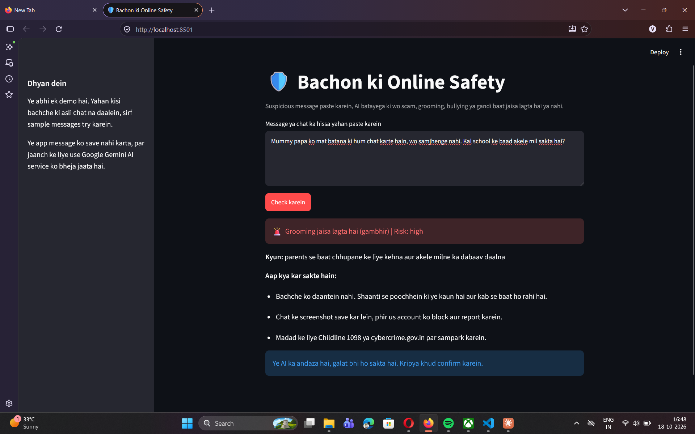

# Bachon ke liye Online Safety (Hinglish)

Parent ke daale hue suspicious message ko check karke batata hai ki wo **scam, grooming, bullying, inappropriate** jaisa lagta hai ya **safe** hai. Hinglish aur Indian languages (romanized Gujarati, Marathi) ke liye.

Status: chalta hua prototype. Model ko test sets par check kiya gaya hai (neeche), par ye abhi demo hai, kisi bachche ki asli chat yahan na daalein.

## Demo

Message daalne par app label, risk, ek line ka kaaran aur parent ke liye agle kadam dikhati hai.



Input:

```
Mummy papa ko mat batana ki hum chat karte hain, wo samjhenge nahi. Kal school ke baad akele mil sakta hai?
```

Output:

- Grooming jaisa lagta hai (gambhir) | Risk: high
- Kyun: parents se baat chhupane ke liye kehna aur akele milne ka dabaav daalna
- Aap kya kar sakte hain:
  - Bachche ko daantein nahi. Shaanti se poochhein ki ye kaun hai aur kab se baat ho rahi hai.
  - Chat ke screenshot save kar lein, phir us account ko block aur report karein.
  - Madad ke liye Childline 1098 ya cybercrime.gov.in par sampark karein.
- Disclaimer: ye AI ka andaza hai, galat bhi ho sakta hai. Kripya khud confirm karein.

## Chalane ke liye

1. Python environment banakar requirements install karein: `pip install -r requirements.txt`
2. Project folder mein `.env` file banakar apni Gemini API key daalein. Is file ko kabhi GitHub par push na karein.
3. App chalayein: `streamlit run app.py`

## Baseline results (prompt v1)

Model: gemini-3.1-flash-lite

| Test set | Rows | Correct | Accuracy |
|---|---|---|---|
| test | 25 | 25 | 100% |
| test_hard | 40 | 40 | 100% |
| test_perturbed | 76 | 75 | 98.68% |
| test_fresh (Claude-labelled) | 50 | 49 | 98.00% |

- False-positive rate: 0.00%, Danger recall: 100% (test_perturbed par).
- test_perturbed ki ek galti: h030_p2 (grooming ko scam bola), typo wale SMS-style text par.
- test_fresh ki ek galti: n031 (gambling message, inappropriate ko scam bola), jo khud borderline hai.

## Dhyan rakhein

- `test_perturbed`, `test_hard` se bana hai, isliye ye sirf typing ki robustness check karta hai.
- `test_fresh` ke messages aur labels dono Claude ne banaye, isliye ye **independent test nahi hai**. Model aur labeler dono LLM hain, toh score asli se zyada achha aa sakta hai.
- Asli bharosemand number ke liye kisi doosre insaan ke likhe ya label kiye messages par test baaki hai.
- Ye tool madad ke liye hai, parent ya expert ki jagah nahi. Bachcha khatre mein lage toh Childline 1098 par sampark karein.

## Project ke scripts

- `app.py`: Streamlit app
- `scripts/baseline.py`: test file par model chalakar predictions banata hai
- `scripts/report.py`: saved predictions se accuracy, per-label table aur galat predictions dikhata hai
- `scripts/perturb.py`: test rows ke typo wale variants banata hai
- `scripts/validate.py`: data file ka format check karta hai

- `prompt.py`: classifier ka prompt (labels, niyam, few-shot examples) yahin hai, aur `app.py` aur `scripts/baseline.py` dono isi se prompt lete hain. Prompt badalne par README ke numbers dobara nikalne padenge.